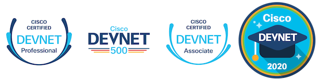



Hi, I'm Josh.

I'm a network engineer from the Twin Cities who has spent the last decade automating networks with code. At [Network to Code](https://networktocode.com/) I deliver network automation solutions built on open source tools, with a lot of focus on network observability and on Nautobot as the network source of truth.

I share what I learn here on the blog, in books, and on stage at user groups and conferences.

<nav class="about-hero__links" aria-label="On this page">
  <a href="#books">Books</a>
  <a href="#speaking">Speaking</a>
  <a href="#podcasts-courses-and-writing">Podcasts</a>
</nav>

<a href="https://linkedin.com/in/josh-vanderaa" target="_blank" rel="noopener">Connect on LinkedIn</a>



## How I got here

I came to network automation the long way around. My degree is in networking, and I spent years as a network engineer before code became part of the job. In 2015 a conference speaker walked through how they had built the event's NOC on Python-driven automation, and I've been working my way down that rabbit hole ever since. It started with Ansible and Python, and has grown into source of truth, telemetry, and CI/CD for the network.

When Cisco launched its DevNet certification program in 2020, I was one of the first 500 people to earn a DevNet certification, starting with the DevNet Associate and following up with the DevNet Professional.

The writing grew out of this blog. During the pandemic I wrote *Open Source Network Management*. That led to co-authoring two Packt books in 2024 and, in 2026, a rebuilt second edition of that first book.

## Books



More on each book is on the [Books]() page.

## Speaking

I enjoy speaking at local user groups as much as at conferences. If you run a networking or automation event and want a talk on source of truth, Nautobot, observability, or getting started with automation, reach out on [LinkedIn](https://linkedin.com/in/josh-vanderaa).



## Podcasts, courses, and writing

### Podcast appearances

- Packet Pushers: [Ansible or Terraform? Choose One](https://packetpushers.net/ansible-or-terraform-choose-one/)
- Network Automation Nerds: [Interview, part 1](https://podcast.networkautomationnerds.com/1864201/12167008-033-interview-with-josh-vanderaa-part-1) and [part 2](https://podcast.networkautomationnerds.com/1864201/12167016-034-interview-with-josh-vanderaa-part-2)

### Ansible course

In 2019 I built a network automation with Ansible course for Packet Pushers, around the time I moved to Network to Code. It was written when NetBox was the only option for a source of truth; today I would reach for Nautobot instead.

- [Ansible for Network Automation](https://ignition.packetpushers.net/courses/ansible-for-network-automation/) on Packet Pushers Ignition
- [The course playlist](https://www.youtube.com/playlist?list=PLtO_OYBiEo6lW_LO-ucRuz7Z8_DJ62NAM) on YouTube
- [Using NetBox for Ansible Source of Truth](https://www.ansible.com/blog/using-netbox-for-ansible-source-of-truth), a guest post on the Ansible blog

### Telemetry and observability writing

- [How to Introduce Telemetry Streaming (gNMI) in Your Network with SNMP with Telegraf](https://www.influxdata.com/resources/how-to-introduce-telemetry-streaming-gnmi-in-your-network-with-snmp-with-telegraf/), an InfluxData webinar
- On the Network to Code blog:
  - [Network Telemetry for SNMP Devices](https://blog.networktocode.com/post/network_telemetry_for_snmp_devices/)
  - [How to Monitor Your VPN Infrastructure with Netmiko, NTC-Templates, and a Time Series Database](https://blog.networktocode.com/post/using_python_and_telegraf_for_metrics/)
  - [Monitor Your Network With gNMI, SNMP, and Grafana](https://blog.networktocode.com/post/monitor_your_network_with_gnmi_snmp_and_grafana/)
  - [Monitoring Websites with Telegraf and Prometheus](https://blog.networktocode.com/post/monitoring_websites_with_telegraf_and_prometheus/)
  - [Alerting with Prometheus](https://blog.networktocode.com/post/prometheus_alerting/)

## Certifications and recognition

  <figure>
    
    <figcaption>Cisco DevNet Professional and Associate, and among the first 500 people DevNet certified</figcaption>
  </figure>
  <figure>
    
    <figcaption>Cisco Champion, 2021</figcaption>
  </figure>

