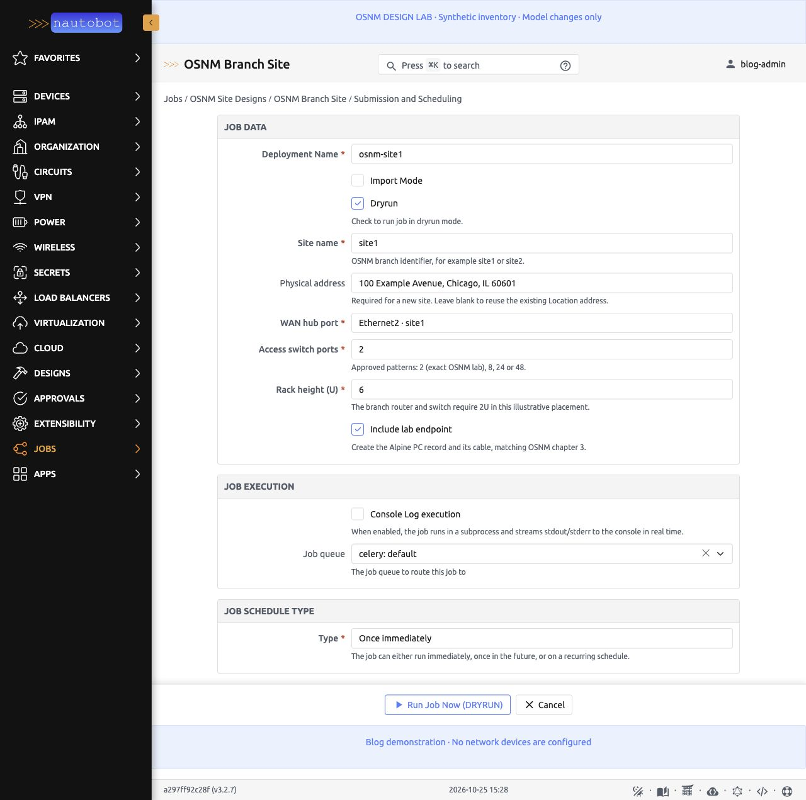
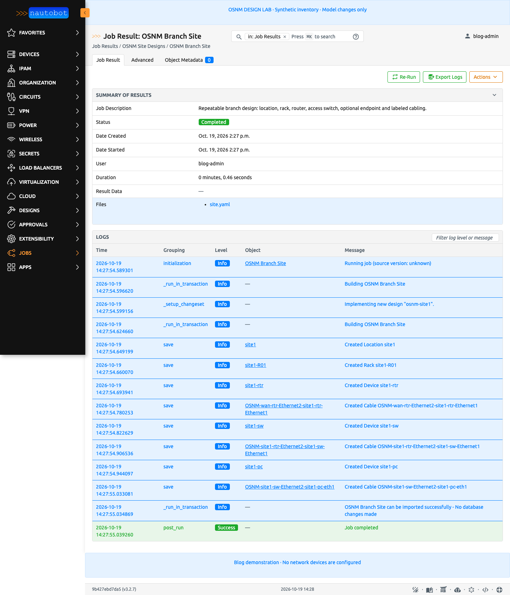
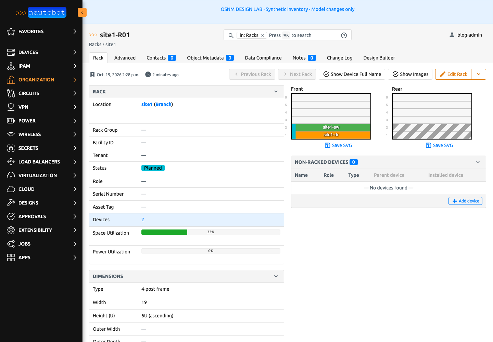
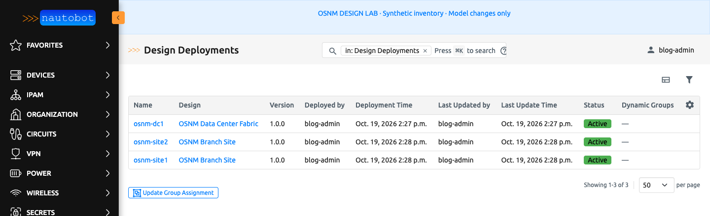

I was listening to the sponsored [Heavy Networking episode HN846](https://packetpushers.net/podcasts/heavy-networking/hn846-how-meter-built-a-topology-design-tool-to-speed-deployments-from-hours-to-seconds-sponsored/) about [Meter](https://www.meter.com/)'s topology design tool, and my immediate thought was, "This must be Nautobot with Design Builder." I don't know what Meter uses internally, but the workflow got me thinking about what we can do with [Nautobot Design Builder](https://docs.nautobot.com/projects/design-builder/en/stable/).

The part that interested me was the work before device configuration: choosing devices, assigning interfaces, and defining connections. Let's work through how we can turn a few inputs into that source-of-truth data.

<!-- more -->

## Start with a branch we can repeat

Meter's [engineering article](https://www.meter.com/blog/automating-network-topology-design) describes engineers entering site requirements, with rules producing the topology, device records, wiring details, and labels. I like the idea of entering those requirements once instead of maintaining a diagram and recreating its decisions in the source of truth.

For this example, the question is smaller: can we describe a branch once, run it again for the same site without duplicates, and use it for the next site? That gives us something concrete to work through in Nautobot.

## Build on the book's lab

For this example, we will build on what we started in my book, [*Open Source Network Management*](), or OSNM for short. We will use the same network topology and add Design Builder Jobs to create its inventory and connections in Nautobot. You can follow the example without having worked through the book.

> [!NOTE]- Advertisement: Open Source Network Management, Second Edition
> A quick plug for my book! [*Open Source Network Management, Second Edition*](https://osnm.josh-v.com/) walks through managing networks with open source tools, including Nautobot, configuration management, metrics, logs, and dashboards. If you want to build out the rest of the environment behind this example, [take a look at the book](https://osnm.josh-v.com/).

I brought up an isolated Docker Compose lab with Nautobot **3.2.7** and Design Builder **3.1.2**. The topology has a two-spine/two-leaf data center, a WAN router, and two branches. Each branch has a router, a switch, and an Alpine endpoint. The screenshots below show native Nautobot Jobs with synthetic inventory.

The data center design creates DC1 and the WAN hub. From there, let's look at the branch Job. It asks for a site name, physical address, WAN hub port, access-port pattern, rack height, and whether to include the endpoint. For site1, I used Ethernet2 on `wan-rtr`. The two-port access pattern matches the book's lab; site2 uses the same design with Ethernet3 on the hub.



*The native branch design form, including the physical address, with dry run enabled.*

The street address was a big part of what caught my attention in the podcast. Here, we store it on the Nautobot Location alongside the site's inventory. A new branch requires an address; on repeat runs, leaving it blank reuses the existing one.

### Work out the address before writing the Location

For this branch, the [Job](https://docs.nautobot.com/projects/design-builder/en/stable/user/design_development/#designjob) collects the inputs. The context works out values such as which address to use and checks the rack space. The template describes the Nautobot objects we want to create or update. Let's look at the address handling first.

If we enter an address, `site_address` uses it. If we leave it blank, it looks for the address already stored on the branch Location. That lets us rerun a site without entering its address again, while still requiring one for a new branch. Here are the Python and YAML excerpts; the full source is linked below.

> [!EXAMPLE]- Python: reuse an address and check rack space
> ```python
> class BranchContext(Context):
>     @property
>     def site_address(self):
>         address = (self.get("physical_address") or "").strip()
>         if address:
>             return address
>         try:
>             return Location.objects.get(
>                 name=self["site_name"], location_type__name="Branch"
>             ).physical_address.strip()
>         except Location.DoesNotExist:
>             return ""
>
>     def validate_site_pattern(self):
>         if self["rack_units"] < 2:
>             raise DesignValidationError(
>                 "The branch pattern needs at least 2U for its router and switch."
>             )
> ```
>
> Other validation checks require an address when none is stored, enforce the approved access-port patterns, and reject a WAN port connected to another site. Imports and the remaining methods are omitted here.

The YAML uses `site_address` to save the resolved value on the Location:

> [!EXAMPLE]- YAML: create or update the branch Location
> ```yaml
> locations:
>   - "!create_or_update:name": "{{ location_name }}"
>     location_type__name: "{{ location_type }}"
>     status__name: "Planned"
>     description: "OSNM enterprise topology / {{ location_name }} / synthetic blog lab"
>     physical_address: {{ site_address | string | tojson }}
> ```
>
> The filters quote the address for YAML, including embedded quotes and line breaks.

The choice of lookup matters when we run site1 again. `!create_or_update:name` looks up an object by name, updating it if found or creating it otherwise. We need stable, unambiguous names so that rerunning the design finds the same objects. For interfaces, the lookup is scoped to the parent device.

The branch also needs its connections. The full template uses `!connect_cable` to connect an interface to its peer. The Job enables `CableConnectionExtension` in `Meta.extensions` to handle that action. The [design development guide](https://docs.nautobot.com/projects/design-builder/en/stable/user/design_development/) has more on the components and template syntax.

You can [download the full template](site.yaml.j2) or the [runnable lab and Job source](osnm-design-builder-lab.zip). The package includes the reference catalog needed by the design.

## Dry run, then apply

I ran the branch design in dry-run mode first. The Job retained its rendered YAML and logs, while inventory counts stayed unchanged. The final log entry says "No database changes made."



*The "Created" entries describe work inside the transaction. Dry run rolled those inventory changes back.*



*The generated site1 rack and elevation. The router and switch occupy two units in this illustrative 6U layout. The `site1-pc` endpoint belongs to the site1 Location and has no rack or position, so it does not appear here.*

## Rerun site1 and repeat for site2

Creating the inventory is one part of the check. We also need to run the design again for an existing site. I re-ran site1 without creating duplicates, so we can reuse the design for that site.

For the second branch, site2 repeats the same design using Ethernet3 on `wan-rtr`, where site1 uses Ethernet2. The branches use different inputs and separate deployment records. To enable that tracking, select Deployment mode with `Meta.design_mode = DesignModeChoices.DEPLOYMENT`; Classic mode is the default. The [design lifecycle docs](https://docs.nautobot.com/projects/design-builder/en/stable/user/design_lifecycle/) explain updates, ownership, and decommissioning.



*The three deployments: `osnm-dc1`, `osnm-site1`, and `osnm-site2`.*

After applying DC1, site1, and site2, Nautobot contained **3 locations, 3 racks, 13 device records, 26 interfaces, and 13 cables**. Nine devices are network equipment and four are endpoints. I checked all thirteen cable pairs against the topology. Invalid rack space and an occupied WAN port were also rejected without changing inventory. Those are the checks completed for this lab.

My recommendation when updating a deployment is to review what will be removed as well as what will be created. If you want to protect managed objects from manual edits, configure [model protection](https://docs.nautobot.com/projects/design-builder/en/latest/admin/install/); the protected-model list defaults to empty.

## Where I would go next

The lab above uses native Job forms and dry-run output. The following additions would be future work.

A broader branch design could ask for endpoint count, growth allowance, hardware profile, and redundancy requirements. We would need to supply the rules for capacity, hardware selection, naming, and uplink assignments. I would keep those calculations in Python, where they can be tested, and use Jinja templates to describe the resulting objects. For inputs that refer to existing Nautobot objects, I would use [ObjectVar fields](https://docs.nautobot.com/projects/core/en/stable/development/jobs/job-structure/#objectvar) so we don't have to type information Nautobot already knows.

If I wanted a graphical topology preview or change comparison, I would build it inside a [Nautobot App](https://docs.nautobot.com/projects/core/en/stable/development/apps/) using the same design logic.

Before expanding the design, I would test capacity boundaries, duplicate names, missing catalog data, conflicting cabling, and changes to existing deployments. The [Design Job testing guide](https://docs.nautobot.com/projects/design-builder/en/stable/user/design_job_testing/) provides a starting point. A physical design also needs checks for PoE, optics, cable reach, rack space, and power.

Device configuration remains a separate step after the intended state is in Nautobot. For getting started, I would keep the scope to a pattern you can check: create the inventory, rerun it for the same site, and repeat it for another site. That is what this branch lab walks through.
