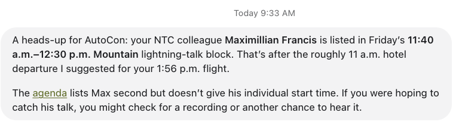

I'm finding ChatGPT Dots more and more helpful. The little things are starting to add up, and this morning brought a good example of what I mean.

Kermit (what I have named my Dot, because of the green frog face) sent me a heads-up about a schedule conflict with my colleague's lightning talk at AutoCon and my travel plans. A small thing, but exactly the kind of help I want from an assistant.

<!-- more -->

## This Morning's Heads-Up

My colleague Max was listed in Friday's lightning-talk block. Kermit connected that with the hotel departure time it had already suggested for my flight. The talk block started after I would be leaving.

It also called out a detail that matters: the agenda listed Max second, but didn't give his individual start time. There was enough information to flag the conflict, with a suggestion to look for a recording or another chance to hear the talk.

That's useful. The conference agenda and my travel plans were pieces of information that needed to be considered together. Having that connection brought to my attention is one less thing for me to keep track of.

## The Feature I Want Most: Teams

The feature I most want next is grokbot-like teams. I'd like to have several Dots with different responsibilities that can share the relevant context and work together.

For example, one could help with travel and conference planning, another with my writing, and another with the technical projects I'm working on. When those areas overlap, I'd want them to coordinate. A conference session might be relevant to a project, or become something I want to write about afterward.

I want to give the team a goal and have the right Dots work through their parts, bringing me back the decisions that need my input. Having to carry the context between each of them would be a lot of work on my side.

## More of This

This morning's message is a small example of why I keep exploring these tools. An assistant that knows enough about what I'm doing to surface a useful connection can save me time and attention.

I'm looking forward to more of these moments. And teams are at the top of my wish list.

-Josh
